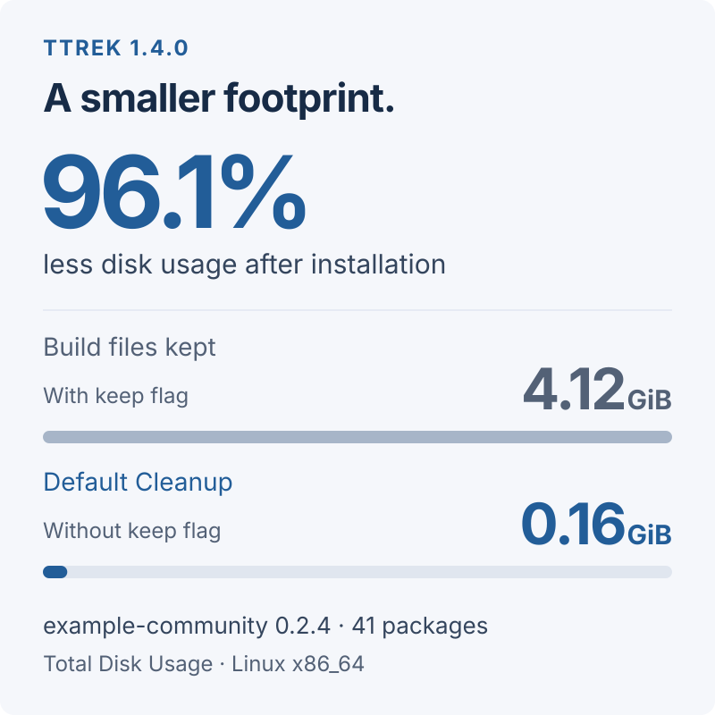

# ttrek 1.4.0: build cleanly, keep what you need

**ttrek 1.4.0 is here!** Successful installs and updates now clean up their
source files and build directories automatically. Need those files for a closer
look? The new **`-keep` flag** leaves them in place.

Compiling a package needs more than the finished program: downloaded archives,
unpacked source code, patches, and intermediate build files all take up space.
Once installation succeeds, most of that material has done its job. ttrek now
clears it away while keeping your installed packages, build logs, and generated
install scripts.

## A community website, with less left behind

The [example-community package](/package/example-community) brings together
accounts, a forum, a wiki, and a blog. Its dependencies include Tcl, OpenSSL,
Tink, and several AWS SDK services: a useful real-world example of how much
space a source build can leave behind.

**`example-community@0.2.4` uses the same 40 dependencies as 0.2.3.** The
figures below come from two installs of 0.2.3 in separate environments using
ttrek 1.4.0: one with `-keep`, the other with default cleanup. Both installed
the same package versions.

The result: **4.12 GiB with build files kept, down to 0.16 GiB (about 164 MiB)
with default cleanup**. That frees **3.96 GiB**, a **96.1% reduction** in the
space occupied by the complete `ttrek-venv` directory.



| Disk usage | With flag | Default |
| --- | ---: | ---: |
| **Total** | **4.12 GiB** | **0.16 GiB** |
| Build | 4,059.5 MiB | 5.1 MiB |
| Installed | 109.7 MiB | 109.7 MiB |

**Build** is `ttrek-venv/build`, including the retained logs and install scripts.
**Installed** is `ttrek-venv/local`. The total also includes metadata and
rollback history. The installed packages occupy essentially the same space;
the saving comes from clearing away the build materials.

Measured on November 14, 2026, on Ubuntu 26.04, Linux x86_64, using default
package options and [this registry snapshot](https://github.com/jerily/ttrek-registry/tree/fd376ff47dd9ffc86109c56764df98e6206c5e07).
We used `du -s -B1 ttrek-venv` after each successful install. Figures are rounded
in binary units (GiB and MiB); savings will vary by platform and dependency
versions. These figures describe space retained after installation. Compilation
still needs temporary working space while it runs.

<!-- Measurement provenance (allocated bytes, GNU du -s -B1):
ttrek 1.4.0 linux-amd64-glibc binary SHA-256:
8c68e0959db2b8c1ef4744fd9dd83fb12b0c49d4f7c97621ab1690a8ce27212a
GCC 15.2.0; CMake 4.5.0; TTREK_MAKE_THREADS=8; 41 packages per run.
Separate initialized projects, same local registry snapshot linked above:
ttrek install -y -keep -fail-verbose example-community@0.2.3
ttrek install -y -fail-verbose example-community@0.2.3
With -keep: total 4422848512; build 4256735232; local 114991104 bytes.
Default:    total  171446272; build    5324800; local 114999296 bytes.
Saved: 4251402240 bytes; percentage calculated from unrounded totals.
-->

## Keep the build when you need it

For an ordinary install, use the same command as before:

```sh
ttrek install -y example-community
```

To preserve the downloaded archives, extracted sources, patches, and build
directories, add `-keep`:

```sh
ttrek install -y -keep example-community
```

It works with updates too:

```sh
ttrek update -y -keep
```

`-keep` applies to that invocation. It is useful when you want to inspect
generated files, investigate a compiler warning, or work on a package recipe.
It does not bring back files already removed by an earlier install, and an
already-installed package is not rebuilt just because you add the flag. Use
`-force` as well when you need to rebuild a package and retain its build files:

```sh
ttrek install -y -force -keep example-community
```

That rebuilds the named package and any installed packages that depend on it;
unchanged dependencies are not rebuilt automatically.

## What gets cleaned up?

Without `-keep`, each successfully installed package's private sources,
patches, and build directory are removed as it finishes. Shared source trees
and downloaded archives stay available until the whole operation succeeds,
including any project build and post-install hook. Then those caches are
removed too.

This builds on [the shared sources introduced in ttrek 1.3.0](/blog/2026-11-13-ttrek-130-saves-space-with-shared-source-files):
packages can reuse one source tree during installation, then release that
space when the work is done.

The files you need afterward stay in place:

- **Installed programs and libraries** remain in `ttrek-venv/local`.
- **Build logs and generated install scripts** remain under `ttrek-venv/build`.
- **A failed package's sources and build files** remain for investigation;
  shared caches are retained if the operation fails.
- **Your root project's own sources and build directory** are unaffected.

A command with nothing to install, or an installation plan you decline, does
not clear out previously retained caches. Updating ttrek itself does not
retroactively clean existing environments.

## Get ttrek 1.4.0

Release binaries are available for Linux amd64 and arm64, with glibc and musl
builds, and for macOS. Update ttrek, then check the installed version:

```sh
ttrek self-update
ttrek version
```

New to ttrek? Follow [Getting started](/docs/getting-started), then try
[building a website](/docs/build-websites-with-ttrek).
