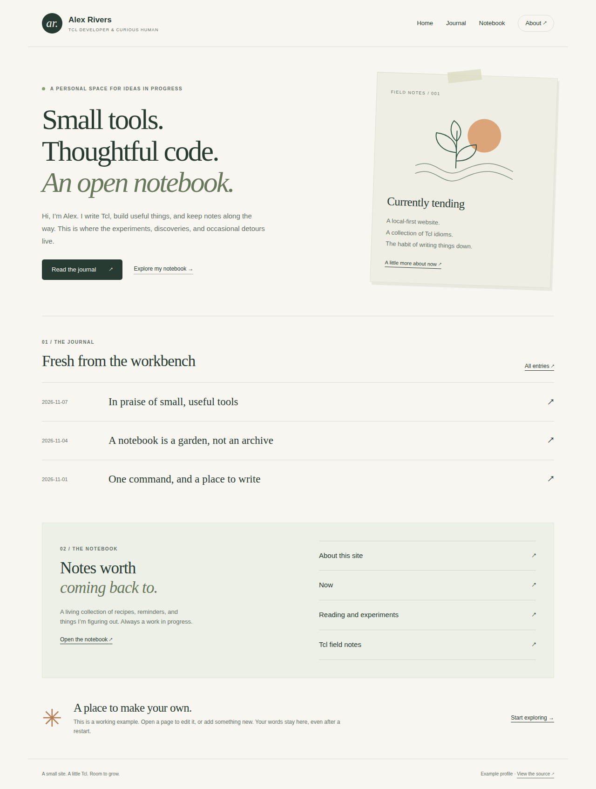
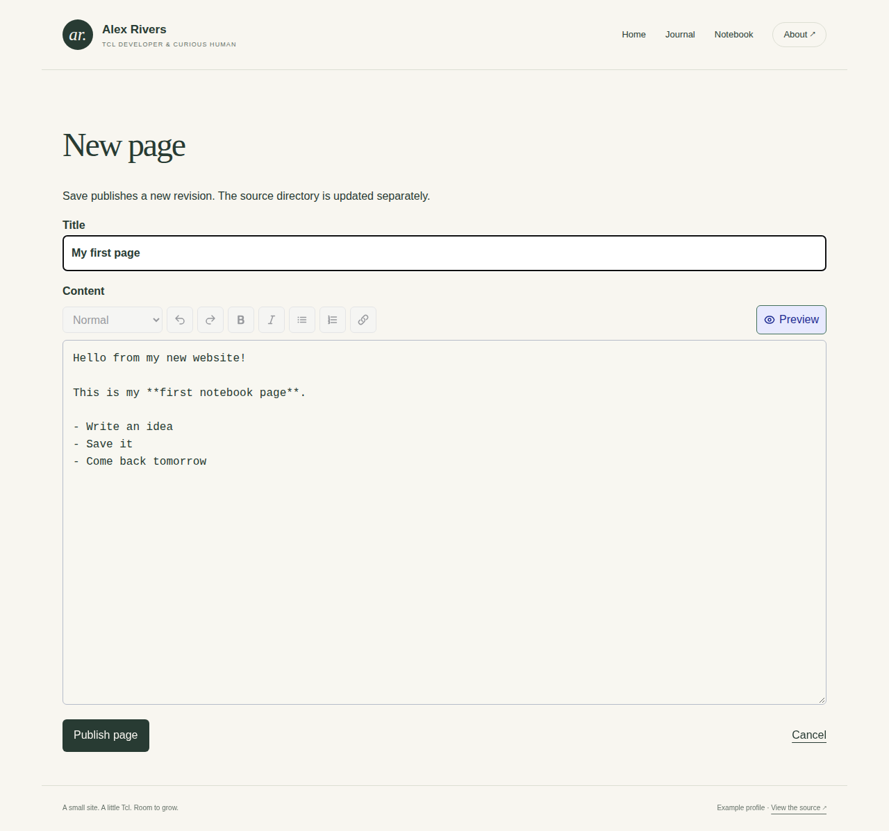
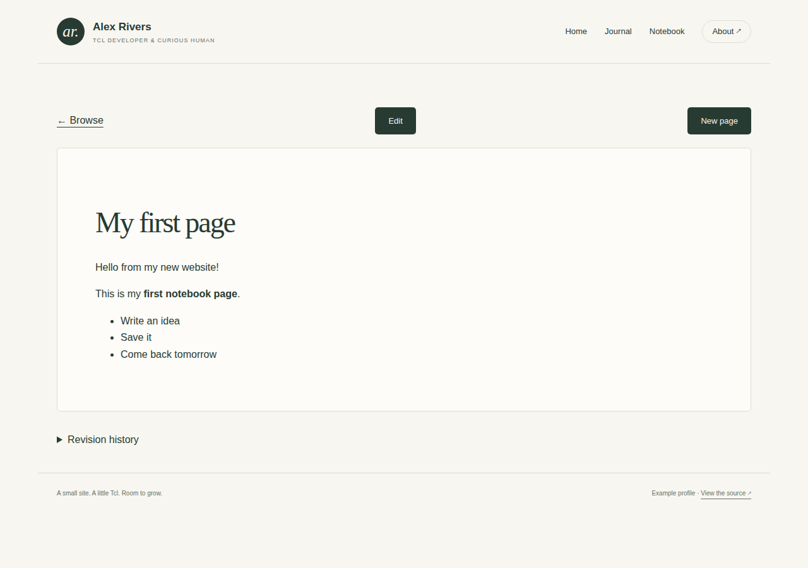
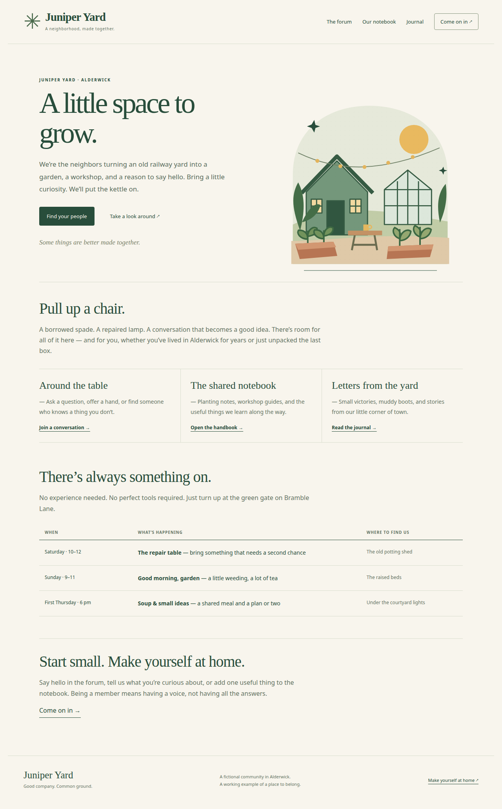
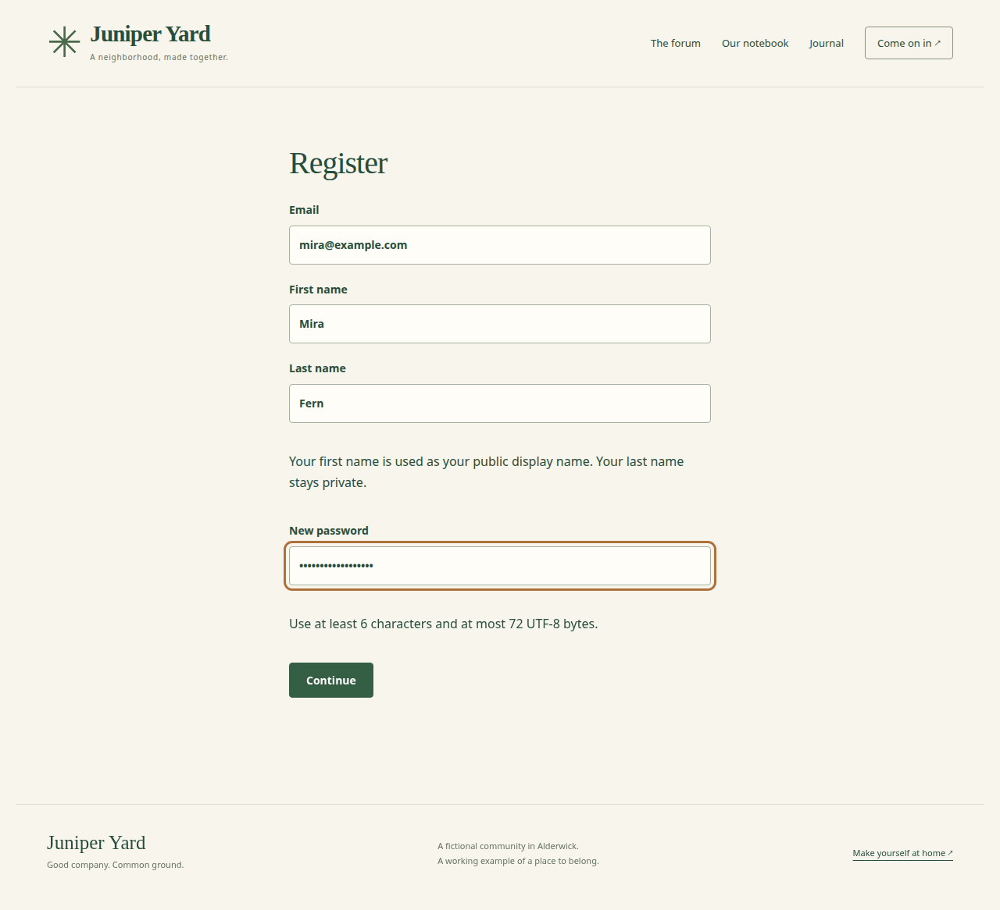
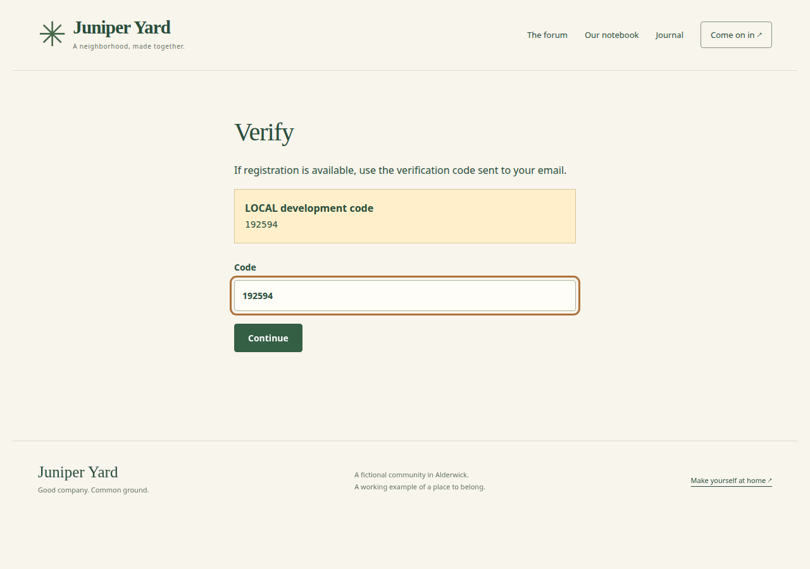
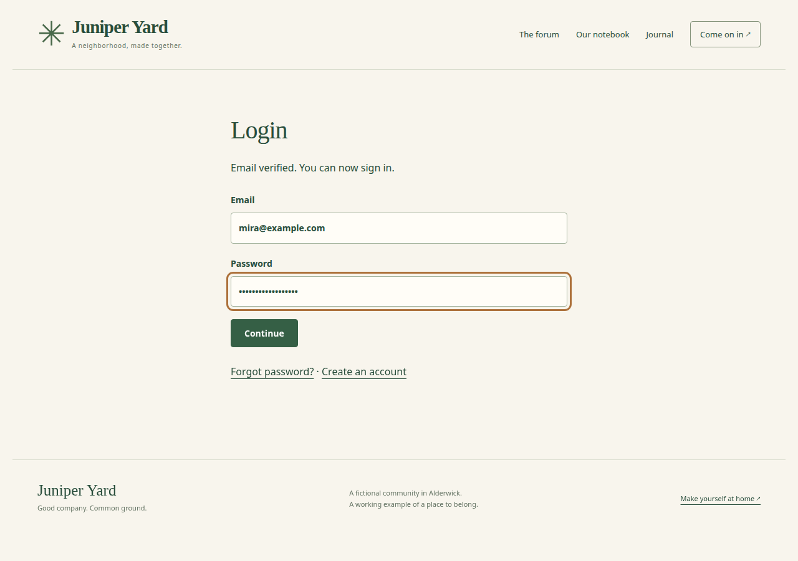
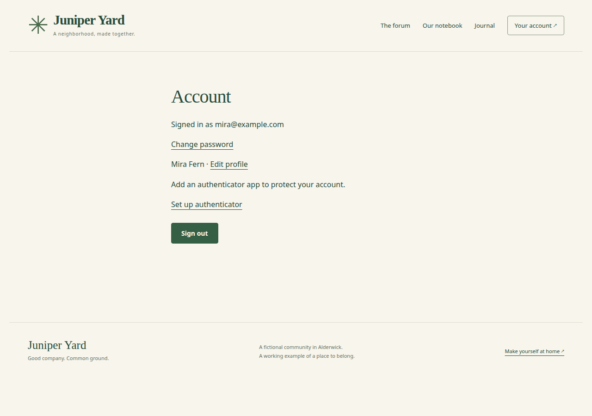
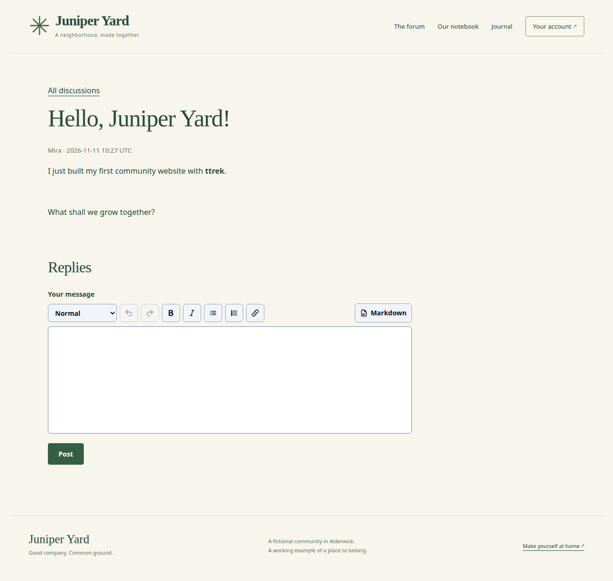

# Build websites with ttrek

Think of an example website as a ready-made kit. It already has pages, a design,
and working buttons. ttrek gets the kit and the other packages it needs. You can
start using it, then change it a little at a time.

In this guide you will run two examples from the public ttrek registry:

| Site | What you get |
| --- | --- |
| Personal | A personal homepage, journal, and notebook that you can edit in your browser. |
| Community | A community homepage, accounts, discussions, a shared notebook, and a journal. |

These websites run on your computer. `localhost` means “this computer”; the
number after it, such as `8080`, tells your browser which local server to visit.

## Before you begin

This guide assumes ttrek is installed. Use a version with `ttrek clone` support
(ttrek 1.1.0 or newer), a terminal, and a browser. Package installation also needs
the [build tools listed in Getting started](/docs/getting-started)
and an internet connection. Some dependencies compile from source, so the first
installation can take a while.

Open a terminal in the folder where you keep your projects. ttrek can look up
packages directly on ttrek.sh, so no separate registry setup is needed.

The steps below use `example-personal-site` 0.1.2 and `example-community` 0.2.2
or newer. The screenshots show those releases running locally, with fictional
demo details.

## 1. Start your personal website

Run these commands one at a time:

```sh
ttrek clone example-personal-site -outdir my-personal-site
cd my-personal-site
ttrek install -y
ttrek run -script start
```

Here is what each command does:

1. **`clone`** downloads the website's source files into `my-personal-site`.
   Choose a new or empty folder.
2. **`cd`** moves your terminal into that folder.
3. **`install -y`** installs the dependencies listed in its `ttrek.json` file.
   Think of that file as the kit's shopping list. `-y` accepts the installation
   plan. The example already has this file, so you do not need `ttrek init`.
4. **`run -script start`** starts the website using the project's start script.

Open **http://localhost:8080** in your browser. Leave the terminal running.



*Your first website: the sample profile belongs to fictional developer Alex Rivers.*

### Write your first page

Click **Notebook**, then **New page**. Enter `My first page` as the title.
You can type in the visual editor, or click **Markdown** to enter this:

```markdown
Hello from my new website!

This is my **first notebook page**.

- Write an idea
- Save it
- Come back tomorrow
```

Markdown is plain text with a few formatting marks: `**words**` makes words bold,
and a line beginning with `-` becomes a list item.



*The editor lets you write a page without changing the website's code.*

Click **Publish page**. Here, “publish” means save it on your local website.
Your browser opens the finished page:



*The saved page is available at `/wiki/my-first-page`.*

The personal example lets you edit without signing in. Keep this example on
localhost; it is intended for local use. Its pages and revisions live in
`data/personal-site.sqlite3`, a database stored as a file. Stop with **Ctrl-C** in
the terminal and run `ttrek run -script start` again: your page is still there.

## 2. Start a community website

Stop the personal server with **Ctrl-C**. From `my-personal-site`, return to its
parent folder and create the second project:

```sh
cd ..
ttrek clone example-community -outdir my-community
cd my-community
ttrek install -y
ttrek run -script start -- --port 8081
```

Open **http://localhost:8081**. The `--` separates ttrek's options from the
website's options; `--port 8081` chooses a different local port. You can also use
plain `ttrek run -script start`, which uses port `8080` by default.

The community example defaults to **LOCAL** mode. It uses a local SQLite
database and shows development verification codes in your browser. You do not
need to set `ENV=LOCAL`, configure PostgreSQL, or connect an email service for
this walkthrough.



*Juniper Yard is a fictional neighborhood garden and workshop. Its accounts and discussions really work.*

## 3. Create an account and sign in

Registration creates your account. Signing in proves that you are the person
who owns it. The community example separates these two steps.

### Register

Click **Come on in** in the top navigation, then **Create an account**.
Fill in an email address, first name, last name, and a password. For this local
exercise, you can use fictional details such as `mira@example.com`, Mira Fern,
and a password you use only for this demo. Your first name appears on posts.



*Click Continue to create the account and move to verification.*

### Verify the account

The next screen shows a **LOCAL development code**. Copy the code displayed in
your own browser into **Code**, then click **Continue**. The code in this
screenshot belongs to a different run; it will not verify your account.



*LOCAL mode displays the code instead of sending an email. This is a development convenience; no email is sent.*

### Sign in

After verification, the login page says **Email verified. You can now sign in.**
Enter the same email and password, then click **Continue**.



*Verification finishes registration; this next step signs you in.*

Your account page now says **Signed in as mira@example.com**, and the navigation
changes to **Your account**. The browser keeps a session cookie so the website
remembers that you are signed in as you move between pages.



*From this page you can change your password, edit your profile, or set up an authenticator app.*

### Try a member action, then sign out

Click **The forum**, then **Start a discussion**. Give it a title such as
`Hello, Juniper Yard!`, write a short message, and click **Post**.



*Your account's first name appears on the discussion. Signed-in members can also create and edit notebook pages and journal entries.*

To sign out, click **Your account**, then **Sign out**. The login page confirms
**You have signed out.** The navigation returns to **Come on in**, and notebook
and journal editing controls disappear. You can still browse the content.
Sign in again with the same account whenever you want to contribute.

## 4. Make the websites yours

Start with one small change. In `my-personal-site/assets/home.html.jinja`, change
“Hi, I’m Alex” to your own introduction.
Stop and restart the server, then refresh your browser.

These files are useful places to explore:

| In your cloned project | What you can change |
| --- | --- |
| `assets/page.html.jinja` | The shared page layout. In the personal example, this also contains Alex's name. |
| `assets/home.html.jinja` in the personal example | The homepage introduction. |
| `assets/site.css` | Colors, spacing, and other visual details. |
| `config.ini` in the community example | Site settings, including `[site] site_name`. |
| The browser's notebook and journal editors | Pages and posts, saved in the local database. |

The personal example imports its `content/wiki/` and `content/blog/` starter
files only when initializing a new database. After that, use the browser to edit
your content. Changing a starter Markdown file will not replace an existing
personal-site page.

The community example stores its local records in `data/community.sqlite3` and
its encryption keys in `data/community.keyset`. Keep those files together. The
sample configuration is enough for this exercise; before collecting real
accounts, follow the cloned project's `readme.md` to set a private email salt
and retain it with your data. Production hosting also needs explicit `ENV=PROD`,
HTTPS, PostgreSQL, persistent keys, and configured email delivery.

## If something gets stuck

| What you see | What to do |
| --- | --- |
| The clone destination already exists | Choose another `-outdir` name, or use a new empty folder. |
| A missing build tool during installation | Install the tool reported by ttrek, then rerun `ttrek install -y`. |
| “Address already in use” | Stop the other server, or run `ttrek run -script start -- --port 8082` and open `http://localhost:8082`. |
| The browser cannot connect | Keep the start command running, check its terminal output, and use the printed `http://localhost:PORT` address. |
| Community startup asks for production configuration | Check whether your shell already sets `ENV=PROD`. In this local-demo terminal, run `unset ENV`, then start again. |
| A verification code is rejected | Use the current code from your own LOCAL screen. Codes expire and can only be used once. |

When you finish, stop each server with **Ctrl-C**. Your project folders and saved
content stay on disk. To return later, open a terminal in the chosen project and
run its start command again.
