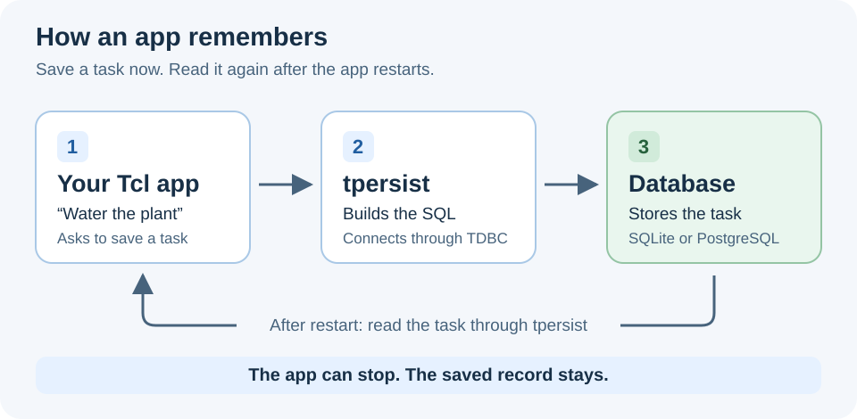
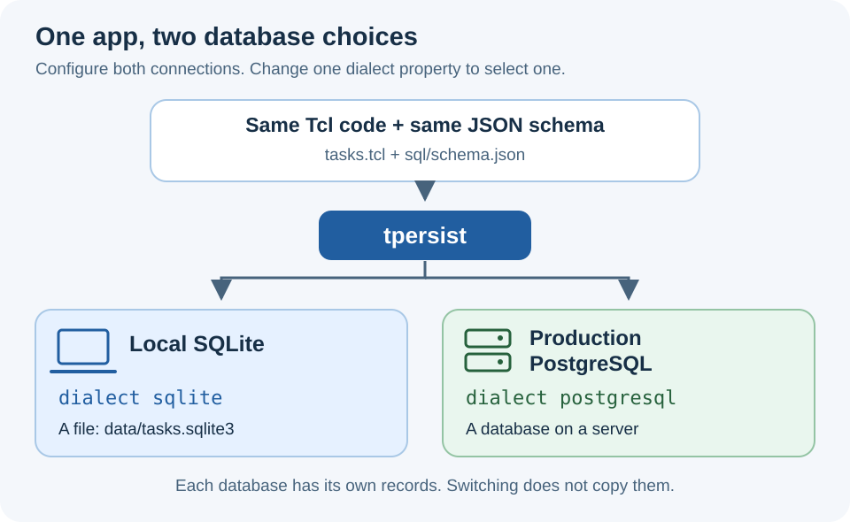
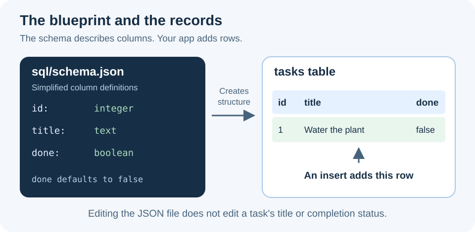

# Database Persistence Layer with tpersist

Imagine your app is a child building something on a play mat. While the app is
running, it remembers everything on the mat. Close the app, and the mat gets
cleared. A database is the cupboard where you put things you want to keep.

**Persistence means saving data so it is still there after your app stops.**
A **database persistence layer** is the part of your app that puts data into
the cupboard and gets it back. In a Tcl app, **tpersist** helps you do this:
describe your tables, build queries, and save or read records.

You can use **SQLite on your local computer and PostgreSQL in production**.
With the two connection profiles configured, changing one `dialect` property
selects the database. The task-list app below uses the same Tcl operations and
the same JSON schema for both.

This guide uses **tpersist 0.1.4**, the latest release as of November 14, 2026,
including its versioned JSON schema format and optional column additions.

## What each piece does



*The database keeps the records. tpersist helps your app talk to it.*

| Piece | Think of it as | Its job |
| --- | --- | --- |
| Your Tcl app | Someone asking to save a note | Decides what to save and when. |
| tpersist | A helper who knows how to file notes | Builds database instructions and runs them. |
| TDBC driver | The connection to the cupboard | Connects Tcl to a particular database. |
| Database | The cupboard | Stores the actual records. |
| JSON schema | A plan for the shelves | Describes the tables, columns, and rules. |

A **table** is like a spreadsheet. Each **row** is one thing, such as a task.
Each **column** is one fact about it, such as its title. **SQL** is the language
used to ask the database to do things. A **dialect** is a database's particular
version of that language.

tpersist builds the SQL for the selected dialect. You still choose the tables,
filters, and changes your app needs.

## SQLite and PostgreSQL



| | SQLite | PostgreSQL |
| --- | --- | --- |
| Where the database lives | A file, such as `data/tasks.sqlite3`. | A database managed by a running PostgreSQL server. |
| What you need | A writable folder and the SQLite driver. | A reachable server, database, login, and PostgreSQL driver. |
| Example use | Developing locally, small apps, or a self-contained tool. | A hosted app with multiple app processes sharing a database. |
| tpersist dialect | `sqlite` | `postgresql` |
| Tcl driver package | `tdbc::sqlite3` | `tdbc::postgres` |

SQLite can also be used in production. Local SQLite plus production PostgreSQL
is one useful arrangement, not a requirement.

## Build a small task list

We will make a command-line app that remembers tasks between runs. It can
**create**, **read**, **update**, and **delete** records. These four operations
are often called **CRUD**.

If you need ttrek or build tools, start with
[Getting started](/docs/getting-started). Then create a project:

```sh
mkdir persistence-demo
cd persistence-demo
ttrek init -y
ttrek install -y tcl tpersist@0.1.4 tdbcsqlite3 tdbcpostgres
mkdir sql
```

This installs both database drivers so the project can use either backend.
tpersist's registry package also brings in `tjson` 1.0.27 or newer to read the
JSON schema. Installing the PostgreSQL driver does not create a PostgreSQL
server or database.

You will create three files:

```text
persistence-demo/
  config.tcl
  tasks.tcl
  sql/
    schema.json
```

The app will create `data/tasks.sqlite3` on its first local run. Keep this data
outside `ttrek-venv`, which holds replaceable installed packages.

## Describe the table in JSON

Save this as **`sql/schema.json`**:

```json
{
  "version": 1,
  "tables": [
    {
      "name": "tasks",
      "columns": {
        "id": {
          "type": "integer",
          "primary_key": true,
          "auto_increment": true
        },
        "title": {"type": "text", "not_null": true},
        "done": {"type": "boolean", "not_null": true, "default": false}
      },
      "indexes": [
        {
          "name": "tasks_done_id",
          "columns": ["done", "id"],
          "descending": ["id"]
        }
      ]
    }
  ]
}
```



*The JSON file describes the structure. Your saved tasks live in the database.*

Here is how to read the blueprint:

- **`version: 1`** identifies tpersist's JSON file format. It is not your app's
  version or a count of database changes. Keep it at `1` when adding tables or
  columns to this format.
- **`tables`** is a list of tables. **`columns`** maps each column name to its
  definition.
- **`id`** is a task's unique number. `primary_key` identifies each row;
  `auto_increment` asks the database to generate the number.
- **`title`** holds text. `not_null` requires a non-NULL value; it does not
  reject an empty string. The app below checks for an empty title.
- **`done`** is a yes/no value. Its default is `false`, so new tasks start
  unfinished when the insert leaves out that column.
- **`indexes`** describes shortcuts the database can use to find rows. This
  index suits looking up tasks by completion status and then newest ID first.
  `descending` applies to `id`; other indexed columns stay ascending.

Use JSON booleans such as `true` and `false`, not quoted strings, for flags.
Defaults are literal values: `false`, `0`, or `"Untitled"`, for example.
`"CURRENT_TIMESTAMP"` is a string, not a request to run a SQL function.

tpersist checks the schema before applying it. It rejects unknown fields,
duplicate definitions, and unsupported format versions. A schema can also
describe multiple tables, unique indexes, and foreign keys, which link one
table's records to another. Put referenced tables first.

## Choose the connection in one place

Save this as **`config.tcl`**:

```tcl
set config {
    dialect sqlite
    sqlite {
        database data/tasks.sqlite3
    }
    postgresql {
        host db.example.com
        port 5432
        database tasks
        user tasks_app
        sslmode verify-full
    }
}
```

This is an application configuration dictionary we define for this example;
tpersist does not load it automatically. The next script reads it and passes
the selected profile to `db_connect`.

Leave `dialect sqlite` for now. The PostgreSQL profile contains example values
to replace when you set up production. No PostgreSQL connection is made in
SQLite mode.

## Write the app

Save this as **`tasks.tcl`**:

```tcl
package require tpersist 0.1.4
namespace import ::tpersist::db_*

# Find config and schema files beside this script, even from another folder.
set root [file dirname [file normalize [info script]]]
source [file join $root config.tcl]

set action [lindex $argv 0]
set argumentCounts {add 2 list 1 done 2 delete 2}
if {![dict exists $argumentCounts $action]} {
    error {Usage: tasks.tcl add "title" | list | done ID | delete ID}
}
if {$argc != [dict get $argumentCounts $action]} {
    error "Wrong number of arguments for $action"
}
set value [lindex $argv 1]
if {$action eq "add" && [string trim $value] eq {}} {
    error "Give the task a title"
}
if {$action in {done delete}} {
    if {![string is wideinteger -strict $value] || $value < 1} {
        error "The task ID must be a positive integer"
    }
}

# Only the connection setup needs to know which database was selected.
set dialect [dict get $config dialect]
set profile [dict get $config $dialect]
if {$dialect eq "sqlite"} {
    set filename [file join $root [dict get $profile database]]
    file mkdir [file dirname $filename]
    dict set profile database $filename
}
set options [list -dialect $dialect -autobegin 0]
dict for {key setting} $profile {lappend options -$key $setting}
set db [db_connect {*}$options]

try {
    # Reapplying this schema creates missing tables/indexes and keeps data.
    db_transaction $db {
        db_apply_schema $db [file join $root sql schema.json]
    }

    switch -- $action {
        add {
            set insert [db_insert tasks]
            set insert [db_values $insert [dict create title [lindex $argv 1]]]
            db_transaction $db {db_execute $db $insert}
            puts "Saved."
        }
        list {
            set query [db_select tasks -expr {id, title}]
            set query [db_where $query -expr {done = FALSE}]
            set query [db_order_by $query -expr {id DESC}]
            set result [db_execute $db $query]
            foreach row [dict get $result rows] {
                puts "[dict get $row id]: [dict get $row title]"
            }
        }
        done {
            set update [db_values [db_update tasks] \
                [dict create done [db_value true -type boolean]] -expressions]
            set update [db_where $update -expr {id = :task_id}]
            db_transaction $db {
                set result [db_execute $db $update \
                    -params [dict create task_id [lindex $argv 1]]]
            }
            puts "Updated: [dict get $result rowcount]"
        }
        delete {
            set remove [db_where [db_delete tasks] -expr {id = :task_id}]
            db_transaction $db {
                set result [db_execute $db $remove \
                    -params [dict create task_id [lindex $argv 1]]]
            }
            puts "Deleted: [dict get $result rowcount]"
        }
    }
} finally {
    db_disconnect $db
}
```

The query commands build instructions. **`db_execute` actually sends them to
the database.** Its `rows` result is a list of Tcl dictionaries, so you read
each column with `dict get`. For these updates and deletes, `rowcount` tells
you how many rows were affected.

The `done` operation uses an explicitly typed boolean so tpersist can represent
“yes” correctly for either database. The app never needs to write separate
SQLite and PostgreSQL versions of the operation.

### Keep values separate from instructions

The title passed to `db_values` is data. A title such as `Mira's shopping list`
does not need manual SQL quoting. In the update and delete, `:task_id` is a
named placeholder filled by `-params`.

Use braces around fixed `-expr` expressions and pass user input as values or
parameters. That keeps user text from becoming part of the SQL instructions.
The `id = :task_id` filter also matters: an update or delete without a filter
can affect every row.

### Save related changes together

A **transaction** is a group of changes that either all succeed or are rolled
back together. `db_transaction` commits when its body succeeds and rolls back
when it raises an error. Put several `db_execute` calls in one transaction
when they must succeed together.

This example uses `-autobegin 0` and explicit transaction blocks. By default,
tpersist starts transactions automatically, even for reads; those need a
commit or rollback. Disconnecting rolls back uncommitted work.

## Run it and see persistence

From your project folder:

```sh
ttrek run tclsh9.1 tasks.tcl add "Water the plant"
ttrek run tclsh9.1 tasks.tcl add "Read a book"
ttrek run tclsh9.1 tasks.tcl list
```

For a new database, the list is:

```text
2: Read a book
1: Water the plant
```

Each command starts a new Tcl process and then exits. The next process can
still read the tasks because they were saved in `data/tasks.sqlite3`.
Close your terminal, open it again, and rerun the list command: they remain.

Now mark task `1` finished:

```sh
ttrek run tclsh9.1 tasks.tcl done 1
ttrek run tclsh9.1 tasks.tcl list
```

Only `2: Read a book` remains in the unfinished list. Task `1` is still in the
database; the query hides completed tasks. To permanently remove task `2`:

```sh
ttrek run tclsh9.1 tasks.tcl delete 2
ttrek run tclsh9.1 tasks.tcl list
```

The unfinished list now prints nothing. Use the IDs from your own list if
your database already contained tasks.

## Switch to PostgreSQL for production

First provision a PostgreSQL server, a database named `tasks`, and an app login
that can create the example's tables and indexes and read and write its rows.
Set the PostgreSQL profile's host, port, database, and user to your deployment
values. Supply the password through your deployment environment, for example
`PGPASSWORD`, or a PostgreSQL password file. For `sslmode verify-full`, configure
the trusted server CA, for example through `PGSSLROOTCERT`.

**Once both profiles are configured, the switch is one property in `config.tcl`:**

```tcl
    dialect postgresql
```

Run the same commands:

```sh
ttrek run tclsh9.1 tasks.tcl add "My first production task"
ttrek run tclsh9.1 tasks.tcl list
```

The same `sql/schema.json` creates the PostgreSQL table, and the same Tcl
queries read and write it. tpersist gets the dialect from the connection and
generates the appropriate SQL, including SQLite's generated integer key or
PostgreSQL's identity column.

**Switching the connection does not copy your data.** Your local tasks stay
in the SQLite file. PostgreSQL has its own records; moving existing records
between databases is a separate export/import task. The server and credentials
also need to exist before changing that property.

This example sticks to features shared by both databases. Other applications
should test their queries and data types on the production backend too;
tpersist does not make every database feature behave identically.

## Grow the JSON schema without losing tasks

By default, `db_apply_schema` creates missing tables and indexes. It leaves
existing definitions and rows intact. Editing an existing column's type in
the JSON file does not change that column in the database.

Suppose you want to add a note to each task. Add this entry inside `columns`
in `sql/schema.json`, with a comma separating it from the preceding entry:

```json
"note": {"type": "text", "not_null": true, "default": ""}
```

Then replace the schema call inside the app's existing transaction with:

```tcl
db_apply_schema $db [file join $root sql schema.json] -additive true
```

This also adds supported missing columns to existing tables. Existing tasks
get an empty note, and their IDs, titles, and completion status stay intact.
Keep `"version": 1`. The app can start reading or writing `note` when you add
that feature.

There are a few boundaries to this convenience:

- A new `not_null` column needs a non-NULL literal default for existing rows.
- Existing column types, defaults, and index definitions are left unchanged.
  Removing an entry from JSON does not drop it from the database.
- Renames, type changes, and adding primary-key, auto-increment, inline-unique,
  or foreign-key columns to existing tables need a separate migration. A
  migration is a deliberate set of steps for changing an existing database.
- tpersist 0.1.4 has no migration runner or migration history table.

For SQLite and PostgreSQL, the surrounding `db_transaction` makes schema
application atomic: a failure rolls back that group of schema changes. In an
app with multiple running processes, apply additive schema changes once during
deployment, before starting those processes, so they do not race to add columns.

## See how the same schema becomes different SQL

Save this optional script as **`inspect-schema.tcl`** beside `tasks.tcl`:

```tcl
package require tpersist 0.1.4
namespace import ::tpersist::db_*

set root [file dirname [file normalize [info script]]]
set schema [db_read_schema [file join $root sql schema.json]]
set table [lindex [dict get $schema tables] 0]
foreach dialect {sqlite postgresql} {
    puts "$dialect:"
    puts [db_schema_sql $table -dialect $dialect]
}
```

Run `ttrek run tclsh9.1 inspect-schema.tcl`. This reads the JSON and prints
the table-creation SQL for both dialects **without opening a database**.
`db_read_schema` reads the blueprint; `db_schema_sql` translates a table
definition; `db_apply_schema` applies the blueprint to a connection.

For more examples, see the
[tpersist examples](https://github.com/jerily/tpersist/tree/v0.1.4/examples),
[JSON schema reference](https://github.com/jerily/tpersist/blob/v0.1.4/docs/schema-json.md),
and [API reference](https://github.com/jerily/tpersist/blob/v0.1.4/docs/api.md).
